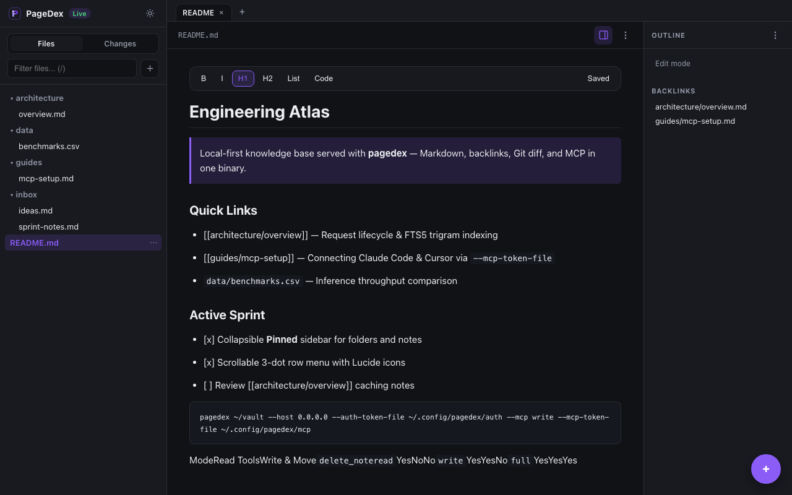
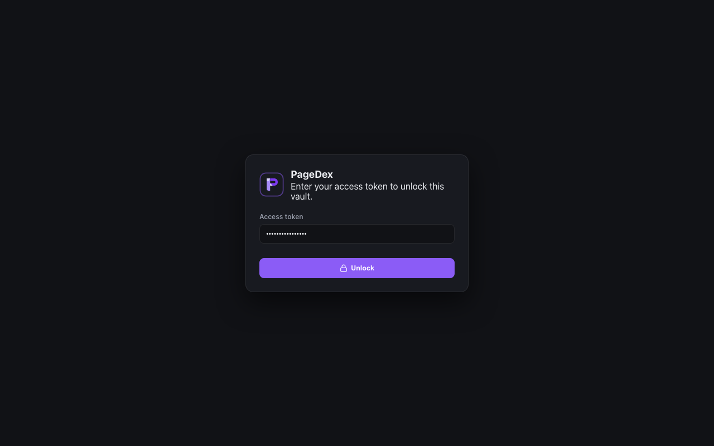

<div align="center">
  
  <h1>PageDex</h1>
  <p>A fast, browsable catalog (<strong>-dex</strong>, like Rolodex/Pokédex) for any local folder of notes and files, with full-text search, backlinks, Git, and MCP.</p>
  <p>
    <a href="#screenshots">Screenshots</a> ·
    <a href="#quick-start">Quick Start</a> ·
    <a href="#mcp-for-ai-agents">MCP Setup</a> ·
    <a href="./docs/README.md">Full Docs</a>
  </p>
</div>

**PageDex** turns any plain directory on disk into an instant, zero-lock-in knowledge workspace—combining a Markdown reader & WYSIWYG editor, `[[wikilink]]` backlinks, SQLite FTS5 trigram search, built-in Git diff/commit, and a permission-scoped MCP server on one port. Your folder stays 100% clean (the search index lives outside at `~/.cache/pagedex/`).


## Who is it for?

| Who | Why PageDex |
|---|---|
| **Obsidian users** | Browse, search, and edit your Obsidian notes from any browser or phone (over LAN/Tailscale) with `[[wikilinks]]`, backlinks, and SSE live reload alongside Obsidian Sync—no extra clutter |
| **Git-backed notes & repos** | Live-reloads on external edits via SSE and lets you inspect diffs, discard changes, commit, and push directly from the UI |
| **Developers & tech writers** | Explore repo `docs/`, preview sandboxed HTML, CSV, PDF, and media files, and review/commit changes with the built-in Git diff UI |
| **AI & agent builders** | Connect Claude Code, Codex, Cursor, or custom agents to `/mcp` (`2026-07-28`, `2025-11-25`, `2024-11-05`) with `--mcp read\|write\|full`, `--mcp-git`, and `--mcp-token-file` |
| **Mobile / multi-device readers** | Read and pin folders/notes on the go with a responsive touch UI (edge-swipe drawers, bottom quick bar) without installing a native app |

## Screenshots

| WYSIWYG Editor (Tiptap) | Quick Switcher (`Cmd/Ctrl+K`) |
|---|---|
|  |  |

| Token Lock Screen (`--auth-token-file`) | Mobile View & Bottom Bar |
|---|---|
|  |  |

## Quick Start

**Requirement:** Node.js `>= 22.5.0` (uses built-in `node:sqlite` for FTS5 trigram search).

```bash
# Serve the current folder on http://127.0.0.1:4321 and open your browser
npx pagedex --open

# Serve an Obsidian vault or docs folder on your LAN / Tailscale
npx pagedex ~/vault --host 0.0.0.0 --port 4321
```

One server exposes everything on the same port:
- **`/`** — React + Tiptap web UI (desktop tabs, pinned folders/notes, outline & backlinks, mobile edge-swipe drawers)
- **`/api/v1/*`** — REST API for reading, editing, searching, uploading, and Git diff/commit
- **`/mcp`** — Multi-era MCP endpoint (`2026-07-28`, `2025-11-25` Streamable HTTP, `2024-11-05` HTTP+SSE)

### Common Recipes

```bash
# Read-only web + MCP mode (safe for browsing/sharing)
npx pagedex ~/vault --read-only

# LAN access with Web/REST auth lock + write-scoped MCP (comma-separated tokens supported for rotation)
npx pagedex ~/vault --host 0.0.0.0 --auth-token-file ~/.config/pagedex/auth-tokens --mcp write --mcp-token-file ~/.config/pagedex/mcp-token

# Allow MCP create/edit/move + local git_commit / git_discard (never auto-pushes)
npx pagedex ~/vault --mcp write --mcp-git
```

### CLI Options

```text
Usage:
  pagedex [dir] [options]

Arguments:
  dir                        Directory to serve (defaults to current working directory)

Options:
  -p, --port <port>          Port to listen on (default: 4321, or PORT env)
  -H, --host <host>          Host to bind (default: 127.0.0.1, or HOST env; use 0.0.0.0 for LAN)
  -o, --open                 Open browser after starting
  --mcp <mode>               MCP mode: read, write, full (default), or off (or PAGEDEX_MCP_MODE)
  --mcp-git                  Enable MCP git_commit and git_discard tools (or PAGEDEX_MCP_GIT=1)
  --mcp-token-file <path>    File containing comma-separated Bearer tokens for /mcp (or PAGEDEX_MCP_TOKEN_FILE)
  --auth-token-file <path>   File containing comma-separated tokens for Web & REST auth (or PAGEDEX_AUTH_TOKEN_FILE)
  --read-only                Disable all REST & MCP write/delete mutations (or PAGEDEX_READ_ONLY=1)
  -v, --version              Show version
  -h, --help                 Show this help
```

## MCP for AI Agents

Point Claude Code, Codex, Cursor, or any HTTP MCP client at `http://127.0.0.1:4321/mcp`:

```json
{
  "mcpServers": {
    "pagedex": {
      "url": "http://127.0.0.1:4321/mcp"
    }
  }
}
```

- **Read tools:** `list_vault`, `read_note`, `search_vault`, `get_vault_info`, `get_note_links`, `git_status`, `git_diff`
- **Write tools (`write`, `full`):** `write_note`, `move_path`
- **Destructive (`full`):** `delete_note`
- **Git (`--mcp-git`):** `git_commit`, `git_discard`

See **[docs/MCP.md](./docs/MCP.md)** for token auth headers and full tool schemas.

## Search Index Cache

The SQLite FTS5 trigram index is stored outside your target folder at `~/.cache/pagedex/<hash>.db` (override with `PAGEDEX_INDEX_DIR` or `PAGEDEX_INDEX_PATH`) so running `pagedex` never dirties `git status`.

## Documentation

- [Getting Started](./docs/getting-started.md) — CLI flags, UI features, wikilinks, Git sync, and mobile gestures
- [Supported File Types](./docs/supported-files.md) — Markdown, sandboxed HTML, PDF, audio/video, CSV/TSV, SVG, and code
- [MCP Server Guide](./docs/MCP.md) — Scoped MCP modes, `--mcp-token-file`, and all 12 tools
- [MCP & REST API](./docs/mcp-and-api.md) — REST endpoints, `/raw/*`, and SSE live reload
- [Security Model](./docs/security.md) — Sandboxed HTML iframes, CSP/CORS, `Origin: null` guard, and path protection
- [Development & Release](./docs/development.md) — Local dev, tests, and npm packaging

## Development

```bash
pnpm install
pnpm dev              # Hono API/MCP on :4321 + Vite HMR on :5173
pnpm build            # Build production UI into dist/
pnpm test             # Run unit tests
pnpm test:playwright  # Run Playwright E2E tests
pnpm smoke            # Run REST + multi-era MCP smoke checks
```

## macOS Background Service (`launchd`)

To run PageDex automatically at login (and keep it alive) via `launchd`, create `~/Library/LaunchAgents/com.pagedex.vault.plist` (or swap `ProgramArguments` for `pnpm vault` if running from a local repo clone):

```xml
<?xml version="1.0" encoding="UTF-8"?>
<!DOCTYPE plist PUBLIC "-//Apple//DTD PLIST 1.0//EN" "http://www.apple.com/DTDs/PropertyList-1.0.dtd">
<plist version="1.0">
<dict>
  <key>Label</key>
  <string>com.pagedex.vault</string>
  <key>ProgramArguments</key>
  <array>
    <string>/opt/homebrew/bin/npx</string>
    <string>-y</string>
    <string>pagedex</string>
    <string>/Users/yourname/vault</string>
    <string>--host</string>
    <string>0.0.0.0</string>
    <string>--auth-token-file</string>
    <string>/Users/yourname/.config/pagedex/auth-token</string>
    <string>--mcp-token-file</string>
    <string>/Users/yourname/.config/pagedex/mcp-token</string>
  </array>
  <key>EnvironmentVariables</key>
  <dict>
    <key>PATH</key>
    <string>/opt/homebrew/bin:/usr/local/bin:/usr/bin:/bin:/usr/sbin:/sbin</string>
    <key>HOME</key>
    <string>/Users/yourname</string>
  </dict>
  <key>RunAtLoad</key>
  <true/>
  <key>KeepAlive</key>
  <true/>
  <key>StandardOutPath</key>
  <string>/Users/yourname/Library/Logs/pagedex-vault.log</string>
  <key>StandardErrorPath</key>
  <string>/Users/yourname/Library/Logs/pagedex-vault.err.log</string>
</dict>
</plist>
```

Manage the service with `launchctl`:

```bash
# Start / load
launchctl bootstrap gui/$(id -u) ~/Library/LaunchAgents/com.pagedex.vault.plist

# Restart
launchctl kickstart -k gui/$(id -u)/com.pagedex.vault

# Stop / unload
launchctl bootout gui/$(id -u) ~/Library/LaunchAgents/com.pagedex.vault.plist

# Status & logs
launchctl print gui/$(id -u)/com.pagedex.vault
tail -f ~/Library/Logs/pagedex-vault.log ~/Library/Logs/pagedex-vault.err.log
```

## Linux Background Service (`systemd --user`)

To run PageDex automatically on Linux via `systemd` user services, create `~/.config/systemd/user/pagedex-vault.service`:

```ini
[Unit]
Description=PageDex Vault
After=network-online.target

[Service]
Type=simple
ExecStart=/usr/bin/env npx -y pagedex %h/vault --host 0.0.0.0 --auth-token-file %h/.config/pagedex/auth-token --mcp-token-file %h/.config/pagedex/mcp-token
Restart=always
RestartSec=3

[Install]
WantedBy=default.target
```

Manage the service with `systemctl --user`:

```bash
# Reload units, enable on login, and start
systemctl --user daemon-reload
systemctl --user enable --now pagedex-vault.service

# Restart / stop
systemctl --user restart pagedex-vault.service
systemctl --user stop pagedex-vault.service

# Status & logs
systemctl --user status pagedex-vault.service
journalctl --user -u pagedex-vault.service -f
```

> **Tip:** To keep the service running after you log out (e.g., on a headless server), run `sudo loginctl enable-linger $USER`.
