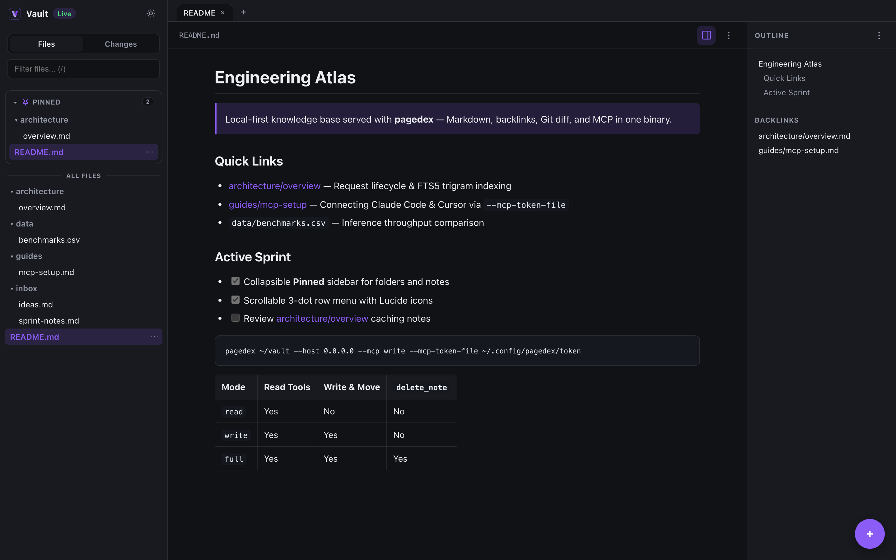
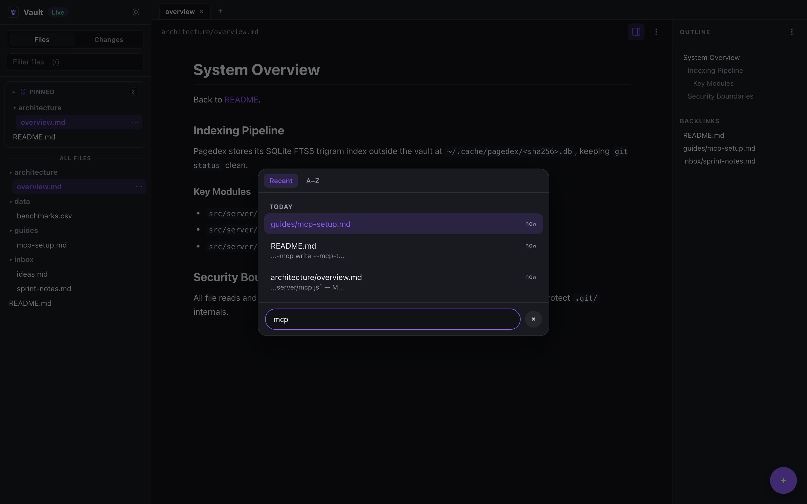
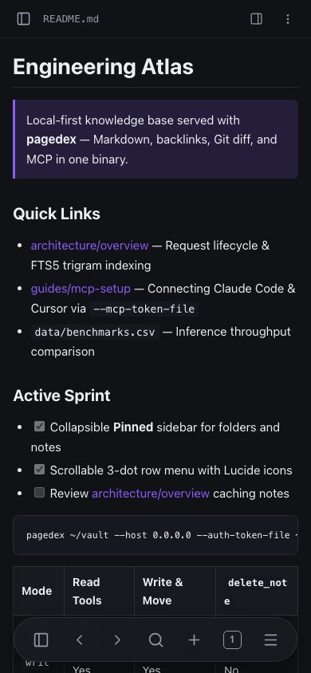

# pagedex

> A fast, browsable catalog (**-dex**, like Rolodex/Pokédex) for any local folder of notes and files—served as a web **page** with full-text search, backlinks, Git sync, and MCP.

**pagedex** turns any plain directory on disk into an instant, zero-lock-in knowledge workspace—combining a Markdown reader & WYSIWYG editor, `[[wikilink]]` backlinks, SQLite FTS5 trigram search, built-in Git diff/commit, and a permission-scoped MCP server on one port. Your folder stays 100% clean (the search index is stored outside at `~/.cache/pagedex/`).

### Who is it for?

| Who | Why `pagedex` |
|---|---|
| **Obsidian users** | Browse, search, and edit your existing Obsidian vault from any browser or phone (over LAN/Tailscale) with `[[wikilinks]]` and backlinks—no cloud fees or extra vault clutter |
| **Obsidian Sync / Git vaults** | Works cleanly alongside Obsidian Sync (with SSE live reload on external edits) and lets you review diffs, commit, and push directly from the web UI |
| **Developers & tech writers** | Explore repo `docs/`, preview sandboxed HTML, CSV, PDF, and media files, and review/commit changes with the built-in Git diff UI |
| **AI & agent builders** | Connect Claude Code, Cursor, or custom agents to `/mcp` (`2026-07-28`, `2025-11-25`, `2024-11-05`) with `--mcp read\|write\|full`, `--mcp-git`, and `--mcp-token-file` |
| **Mobile / multi-device readers** | Read and pin folders/notes on the go with a responsive touch UI (edge-swipe drawers, bottom quick bar) without installing a native app |

## Requirements

- **Node.js `>= 22.5.0`** (uses built-in `node:sqlite` for FTS5 trigram search)

## Quick Start

```bash
npx pagedex [dir]
```

By default, `pagedex` serves the current directory on `http://127.0.0.1:4321`:

- `/` — React + Tiptap web UI (desktop & mobile with edge-swipe drawers + long-press tree actions)
- `/api/v1/*` — REST API for reading, editing, searching, and Git diff/commit
- `/mcp` — MCP endpoint supporting `2026-07-28` (`server/discover`), `2025-11-25` Streamable HTTP, and `2024-11-05` HTTP+SSE (see [MCP Server Guide](./docs/MCP.md))

## Screenshots

| Desktop Preview & Pinned Sidebar | WYSIWYG Editor (Tiptap) |
|---|---|
|  |  |

| Quick Switcher (`Cmd/Ctrl+K`) | Mobile View & Bottom Bar |
|---|---|
|  |  |

### CLI Options

```text
Usage:
  pagedex [dir] [options]

Arguments:
  dir                        Directory to serve (defaults to current working directory)

Options:
  -p, --port <port>          Port to listen on (default: 4321, or PORT env)
  -H, --host <host>          Host to bind (default: 127.0.0.1, or HOST env; use 0.0.0.0 for LAN)
  -o, --open                 Open browser after starting
  --mcp <mode>               MCP mode: read, write, full (default), or off (or PAGEDEX_MCP_MODE)
  --mcp-git                  Enable MCP git_commit and git_discard tools (or PAGEDEX_MCP_GIT=1)
  --mcp-token-file <path>    File containing Bearer token for /mcp (or PAGEDEX_MCP_TOKEN_FILE)
  --read-only                Disable all REST & MCP write/delete mutations (or PAGEDEX_READ_ONLY=1)
  -v, --version              Show version
  -h, --help                 Show this help
```

### Examples

```bash
# Serve current folder on default port 4321
npx pagedex

# Serve a specific notes folder on LAN/Tailscale with read-only MCP and Bearer token file
npx pagedex ~/vault --host 0.0.0.0 --mcp read --mcp-token-file ~/.config/pagedex/mcp-token

# Allow MCP create/edit/move + local git commit/discard without delete_note
npx pagedex ~/vault --mcp write --mcp-git
```

## Search Index Cache

The SQLite FTS5 trigram index is stored outside your target folder at `~/.cache/pagedex/<hash>.db` (override with `PAGEDEX_INDEX_DIR` or `PAGEDEX_INDEX_PATH`) so running `pagedex` never dirties `git status`.

## Development

```bash
pnpm install
pnpm dev      # Hono API/MCP on :4321 + Vite HMR on :5173
pnpm build    # Build production UI into dist/
pnpm test     # Run unit tests
pnpm test:playwright # Run Playwright E2E tests
pnpm smoke    # Run REST + multi-era MCP smoke checks
```

See [docs/README.md](./docs/README.md) for full documentation.
