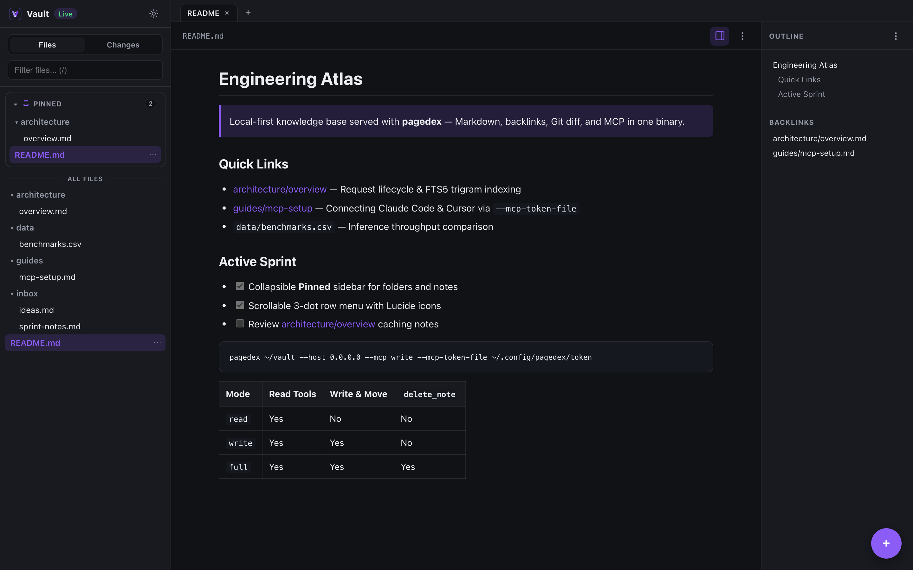

# Getting Started

`pagedex` turns any local folder of notes, code, media, and HTML into a fast web catalog with full-text search, backlinks, Git sync, and an MCP server on a single port.

## Requirements

- **Node.js `>= 22.5.0`** (uses built-in `node:sqlite` for FTS5 trigram search)

## Running with `npx`

```bash
# Serve the current directory on http://127.0.0.1:4321
npx pagedex

# Serve a specific folder and open it in your browser
npx pagedex ~/vault --open

# Expose on your LAN / Tailscale IP
npx pagedex ~/vault --host 0.0.0.0 --port 4321
```

### CLI Options

| Flag | Env Var | Default | Description |
|---|---|---|---|
| `[dir]` | `PAGEDEX_ROOT` / `VAULT_ROOT` | `process.cwd()` | Root directory to serve |
| `-p, --port <port>` | `PORT` | `4321` | HTTP port |
| `-H, --host <host>` | `HOST` | `127.0.0.1` | Bind address (`0.0.0.0` for LAN/Tailscale) |
| `-o, --open` | — | `false` | Open browser on startup |
| `--mcp <mode>` | `PAGEDEX_MCP_MODE` | `full` | MCP mode: `read`, `write`, `full`, or `off` |
| `--mcp-git` | `PAGEDEX_MCP_GIT` | `false` | Enable `git_commit` and `git_discard` MCP tools |
| `--mcp-token-file <path>` | `PAGEDEX_MCP_TOKEN_FILE` | — | File containing Bearer token for `/mcp` |
| `--auth-token-file <path>` | `PAGEDEX_AUTH_TOKEN_FILE` | — | File containing tokens for Web & REST auth |
| `-c, --config <path>` | `PAGEDEX_ROOT_CONFIG` | — | Multi-vault JSON config file (auto-reloads on edit) |
| `--read-only` | `PAGEDEX_READ_ONLY` | `false` | Disable all REST & MCP write/delete mutations |
| `-v, --version` | — | — | Print version |
| `-h, --help` | — | — | Print CLI help |

### Search Index Cache

The SQLite FTS5 trigram index is stored **outside** your target folder at `~/.cache/pagedex/<sha256>.db`, so running `pagedex` never creates untracked files in your Git repository.

Override the cache location with:
- `PAGEDEX_INDEX_DIR` — directory for `<hash>.db` files
- `PAGEDEX_INDEX_PATH` — exact `.db` file path

## Web UI Highlights



- **View Modes (top-right `⋮` menu):**
  - **Preview** — rendered Markdown (with Mermaid diagrams), sandboxed HTML, PDF, audio/video, CSV/TSV tables, or images
  - **Edit** — lazy-loaded Tiptap WYSIWYG editor for Markdown (`.md`, `.markdown`, `.mdx`)
  - **Raw** — editable source (`RawEditor`) for Markdown and all non-binary text/code files (`.txt`, `.json`, `.js`, `.html`, `.csv`, `.svg`, etc.)
  - **Diff** — line-by-line Git diff with per-line, per-hunk, and per-file discard
  - **Download** — downloads any open file via `/api/v1/file?path=...&download=1`
  - **Print** — triggers `window.print()` with an A4 multi-page stylesheet (hides UI chrome and renders Mermaid in light theme; uncheck **Headers and footers** in the browser print dialog to hide the page title/URL)
- **Wikilinks & Backlinks:** `[[note]]` and relative links resolve across the folder, and the outline panel lists incoming backlinks.
- **Git Integration:** Browse changed files in the Changes tab, inspect hunks, discard changes, or commit & push directly from the UI.
- **Live Reload (SSE):** External edits on disk (e.g. from your editor or an AI agent via MCP) refresh open files and the sidebar tree automatically via `/api/v1/events`.
- **Mobile Friendly:** Edge-swipe gestures open the left file drawer and right outline drawer, with long-press context actions in the tree.
